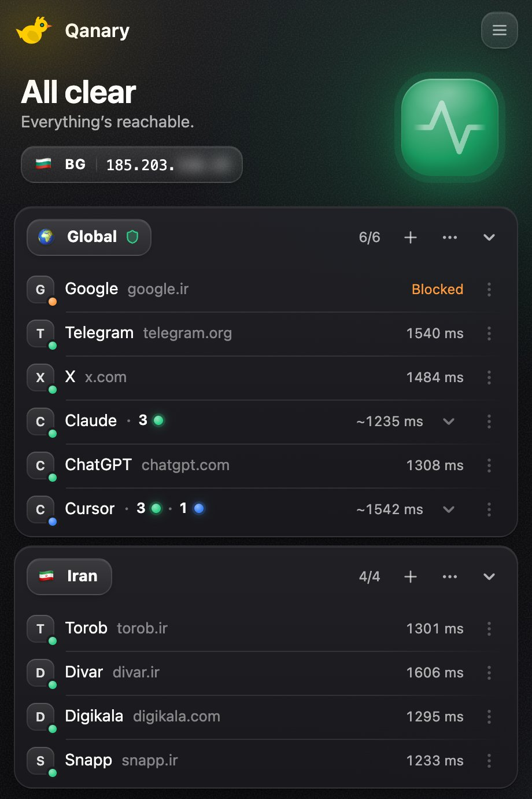
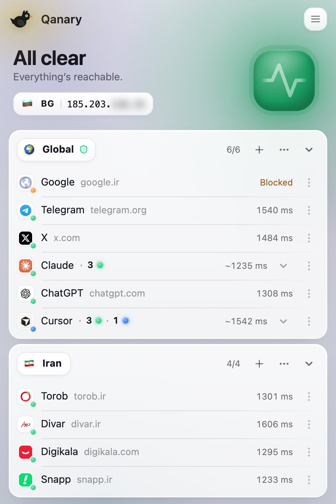

<div align="center">
  
</div>

---

> Miners once carried a [canary down the shaft](https://en.wikipedia.org/wiki/Sentinel_species) — the little bird keeled over from toxic gas long before the crew felt a thing, buying them the minutes that mattered. **Qanary** is that bird for your network: it chirps the moment something you rely on stops answering, so you know before it bites.

<p align="center">
  
  
</p>

Desktop connectivity monitor. Traffic-light status for whether your machine can reach a list of services — useful on restricted or censored networks where some services are blocked and others aren't.

| Severity  | When                                     |
| --------- | ---------------------------------------- |
| 🟢 Green  | Everything reachable                     |
| 🟠 Orange | A non-critical list is fully unreachable |
| 🔴 Red    | A critical list is fully unreachable     |

Seeded defaults: **Global** list is critical (red alarm), **Iran** list is non-critical (orange warn). All lists are fully configurable — flip the **Critical** toggle on any of them.

- Shows WAN IP + country flag.
- **Instant refresh on network changes** — probes the moment the system network state shifts (wifi on/off, ethernet plug/unplug, VPN up/down), so status reflects reality within ~1s instead of waiting out the interval timer.
- **Configurable probe intervals** — critical lists refresh every 30s and non-critical lists every 60s by default (minimum 10s); both adjustable in **Settings**. Each service probes independently, so dots update one by one as their results land.
- **Drag-and-drop reordering** — rearrange lists, the services within them, and the IP provider by dragging.
- Add your own services and lists. Config persisted as local JSON.
- A **status orb** at the top shows the overall state. Pick **Rings** or **Pulse** for it in **Settings**.
- Lives in the **menu bar** with an icon that shows the current status. It follows the orb's style or keeps its own, outline or filled, and its menu shows how each list is doing.
- **Check one thing now**: click a service or a list name to re-check just that one.
- Lists sit **side by side** when the window is wide enough.
- **Mac shortcuts**: ⌘N new list, ⇧⌘O edit order, ⌘, Settings, ⌘R refresh.
- Native **desktop notifications** on critical-list status transitions — fully down, recovery, fully blocked, and total loss of connectivity (with optional sound, at your chosen volume). One alert per check round, at the worst thing found.
- **Launch at login** and **Hide the Dock icon** (macOS) for menu-bar-only operation — both in **Settings**.
- **Dark / light theme** following the system, with a manual override in **Settings**.

## Lists

Each list has a **Critical** toggle (in the add / edit modal). When on, that list going fully down raises a red alarm. When off, it only warns orange.

To edit a list: tap `⋯` next to the list name → **Edit**.

## Notifications

Qanary sends a native desktop notification when a **critical** list changes state — fully down (`up → down`) and again on recovery (`down → up`). Each can carry a sound. Only critical lists notify, so mark a list **Critical** to start receiving them. Toggle notifications and sound in **Settings**.

Two more alerts share those toggles:

- **Blocked** — a critical list whose every endpoint turns blocked, TCP-only endpoints aside (TCP connects, HTTPS fails: the interception fingerprint) gets a dedicated "Blocked" alert instead of the generic outage one. Own toggles, defaulting on.
- **You're offline** — when nothing at all is reachable, you get one app-wide offline alert. Uses the outage toggles; it has no setting of its own.

**One alert per check round.** Each service probes on its own schedule, so a single round's changes land a few seconds apart. Qanary waits for the round to go quiet (a little longer than the probe timeout, at most 12s) and then speaks **once**, at the worst thing it found: offline outranks blocked, which outranks a plain outage. Losing your connection therefore gives one "You're offline" alert, not one per list. A list still down when you come back online is announced at that point rather than being dropped, under its current name — unless you deleted it or made it non-critical in the meantime — and a later round reaching a worse state alerts again. After your Mac wakes from sleep, Qanary gives the network up to 20s to come back before deciding anything changed, then reports the difference once.

**Sound volume** — one level for every alert sound, set with the slider under the alert toggles in **Settings** (0–100%). It applies to Qanary's own sounds only; the notification banners themselves are unaffected, so leaving every Sound box off gives you silent banners. The slider is a level, not a fourth switch: **Muted** (0) silences the audio and leaves your Sound checkboxes exactly as they are, so turning the level back up restores them. The slider goes inactive only when no direction is set to make a sound at all.

## Services

Add services from the modal. Each non-blank line is one service. Editing a service shows its label and endpoints as two separate fields.

- **Custom ports** — `host:port` to probe a specific port instead of 443. Example: `api.example.com:8080`.
- **Multi-endpoint** — comma-separate hosts on one line. Example: `Mail: smtp.example.com:465, imap.example.com:993`. The row rolls up reachable / blocked / down; expand to see each endpoint and latency.
- **Bulk input** — paste many lines at once. One service per line.
- **Label** — prefix with `Label:` to name it (`Search: google.com`). Without a label, the first host becomes the name.

Each service can be edited or removed from its row's `⋯` menu.

A host Qanary can't read (a stray colon, an IPv6 address, port 0) is reported by name and nothing from that line is added.

**Probe timeout** — `timeout_ms` (default 3s) bounds the TCP connect only; the HTTPS check has its own fixed 5s limit.

**Favicons** — service icons are loaded from Google's favicon service (`google.com/s2/favicons`) by hostname. That request tells Google which hosts you monitor, and it fails wherever Google is filtered (the row just shows no icon).

## Stack

- **Tauri v2** (Rust backend) + **React + Vite + TypeScript** frontend.
- Probe = TCP connect + HTTPS HEAD → classify Up / Blocked / Down.
- Config stored at:
  - **macOS:** `~/Library/Application Support/com.qanary.app/config.json`
  - **Linux:** `~/.config/com.qanary.app/config.json`
  - **Windows:** `C:\Users\<user>\AppData\Roaming\com.qanary.app\config.json`

## Develop

```bash
source "$HOME/.cargo/env"   # until login shell picks up cargo
pnpm install                 # frontend deps
pnpm run tauri dev           # run app (dev)
pnpm run tauri build         # release bundle
pnpm test                    # frontend (vitest) + Rust (cargo) tests
pnpm test:e2e                # Playwright end-to-end tests (needs Chrome)
```

`pnpm dev` and then `http://localhost:1420/?mock` runs the interface in a browser on sample data, without the Rust backend. The README screenshots come from that page.

Requires Node, Rust (rustup), and Xcode CLT on mac.

## Releases

Prebuilt apps are on the [Releases page](https://github.com/Esi-Abolfazl/Qanary/releases).

> **First launch (macOS):** Gatekeeper may block the app. Either right-click → Open, or run:
>
> ```bash
> xattr -cr /Applications/Qanary.app
> ```

## In-app updates

Qanary checks for updates silently on every launch and re-checks every ~6 hours while running. An update button appears when a newer version is available — you can also trigger a check from **Settings**. After it relaunches, a what's-new dialog shows the new version's release notes.
